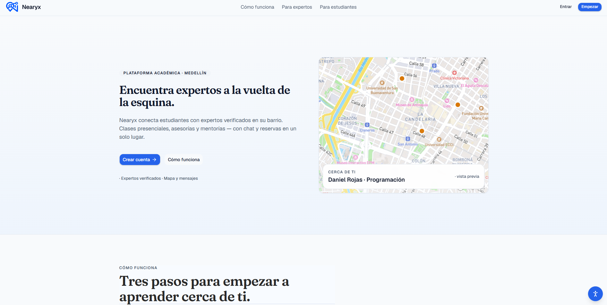
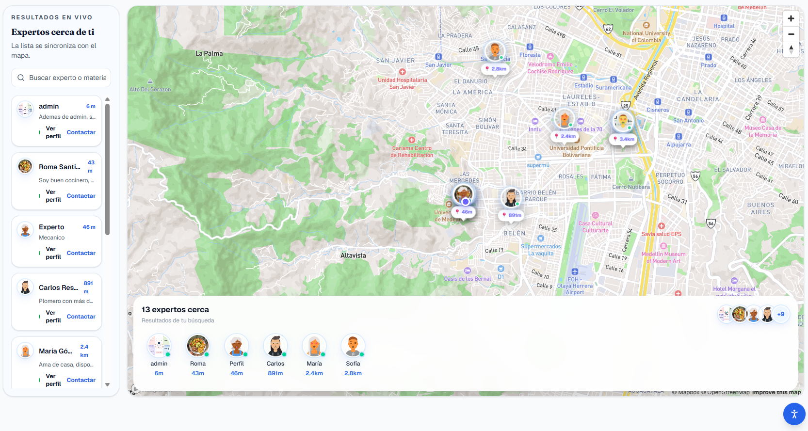

# Nearyx — Frontend

Plataforma web que conecta estudiantes con expertos verificados cerca de ellos en Medellín: mapa en vivo, feed, chat y reservas.

## Despliegue

| | Link |
|---|---|
| Sitio (producción) | https://nearyx-working.onrender.com |
| API (gateway) | https://nearyx-gateway.onrender.com |
| Repositorio backend | https://github.com/Santi-a-ux/Nearyx-services |

> El sitio corre en Render (plan gratuito): si lleva un rato sin uso, la primera carga puede tardar cerca de un minuto en despertar el servicio.

## Capturas

| Landing | Explorar (mapa) |
|---|---|
|  |  |

## Stack

Next.js 16 (App Router) · React 19 · TypeScript · Tailwind 4 · shadcn/ui · TanStack Query · Mapbox GL · Docker

## Instalación

```bash
git clone https://github.com/Santi-a-ux/Nearyx-front.git
cd Nearyx-front
cp .env.example .env.local   
npm install
npm run dev                  # http://localhost:3000
```

Otros comandos: `npm run build`, `npm start`, `npm run lint`.

### Con Docker

```bash
docker build \
  --build-arg NEXT_PUBLIC_API_URL=http://localhost:8000 \
  --build-arg NEXT_PUBLIC_WS_URL=ws://localhost:8000 \
  --build-arg NEXT_PUBLIC_MAPBOX_TOKEN=pk.xxxxx \
  -t nearyx-front .
docker run -p 3000:3000 --env-file .env.local nearyx-front
```

Las variables `NEXT_PUBLIC_*` se incrustan al hacer el build: si las cambias, vuelve a construir la imagen.

## Variables de entorno

| Variable | Descripción |
|---|---|
| `NEXT_PUBLIC_API_URL` | URL pública del gateway, con https y sin barra final |
| `INTERNAL_API_URL` | La misma URL, usada por las rutas `/api/*` y el servidor de Next |
| `NEXT_PUBLIC_WS_URL` | Host del WebSocket del chat, sin ruta (`wss://…`) |
| `NEXT_PUBLIC_MAPBOX_TOKEN` | Token público de Mapbox (restríngelo por URL en el panel de Mapbox) |
| `NEXT_PUBLIC_FORCE_MEDELLIN` | `1` centra el mapa en Medellín aunque el usuario esté en otro lugar (por defecto `0`) |
| `COOKIE_SECURE` | Opcional. En producción es `true` por defecto; en local sin HTTPS usa `false` |

El archivo `.env.example` tiene la plantilla; el `.env.local` real nunca se sube al repositorio.

## Autenticación y sesión

- El login y el registro llaman al gateway (`/auth/login`, `/auth/register`) desde *server actions*.
- El token JWT se guarda en una cookie `httpOnly` (`sameSite=lax`, vigencia de 7 días), así que la sesión sobrevive al refrescar la página.
- El logout borra la cookie y lleva a `/login`.
- Si el gateway responde 401, la sesión se cierra y se redirige a `/login`.
- Los errores del backend (credenciales inválidas, correo repetido) se muestran en el formulario.

## Rutas protegidas

Sin sesión, `/dashboard`, `/explore`, `/bookings`, `/messages`, `/profile`, `/tutor` y `/admin` redirigen a `/login` (lo hace `proxy.ts`, el equivalente del middleware en Next 16, así que funciona aunque se escriba la URL a mano).
`/admin` además verifica en el servidor que el rol sea `admin`; con otro rol redirige a `/dashboard`.
Con sesión activa, `/login` y `/register` redirigen al inicio de la app. Hay una página 404 propia (`app/not-found.tsx`).

## Estructura

```
app/            rutas (page.tsx), rutas API que hacen de proxy al gateway
components/     componentes reutilizables (ui/, layout/, map/, profile/, …)
hooks/          hooks compartidos
lib/            cliente HTTP (api.ts), acciones de autenticación, utilidades
public/         recursos estáticos
```

## Credenciales de prueba

Creadas por el seed del backend:

| Rol | Correo | Contraseña |
|---|---|---|
| admin | admin@nearyx.dev | Admin12345! |
| student | estudiante@nearyx.dev | Estudiante12345! |
| tutor | experto@nearyx.dev | Experto12345! |

## Reparto del trabajo

Proyecto realizado de forma individual.

| Integrante | Qué construyó |
|---|---|
| Santiago Gutiérrez Correa | Todo el frontend: landing, login y registro, explorar y mapa, perfiles, chat, reservas y administración |
